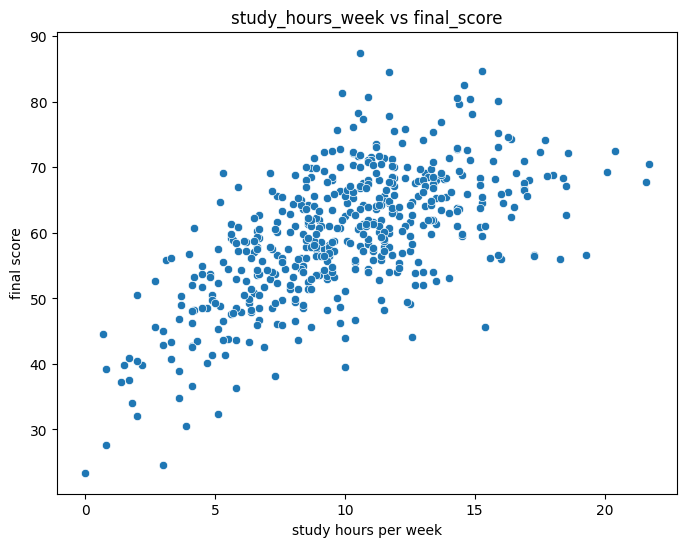
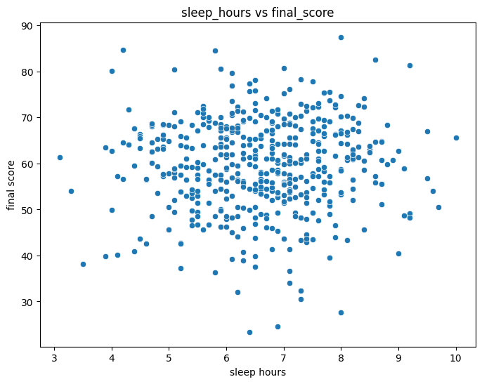
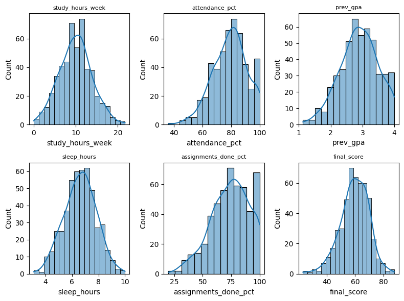
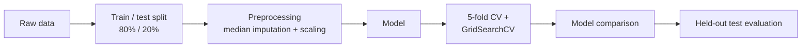

# 🎓 Student Performance Prediction

**End-to-end machine learning project that predicts students' final exam scores and pass/fail outcomes, built with leakage-safe scikit-learn pipelines, cross-validation and hyperparameter tuning.**


---

## Table of Contents

- [Overview](#overview)
- [Highlights](#highlights)
- [Dataset](#dataset)
- [Exploratory Data Analysis](#exploratory-data-analysis)
- [Methodology](#methodology)
- [Results](#results)
- [Limitations and Next Steps](#limitations-and-next-steps)
- [Getting Started](#getting-started)
- [Repository Structure](#repository-structure)
- [Author](#author)

---

## Overview

Schools and instructors want to know **which students are likely to struggle, and why**. This project uses student study habits and background information to solve two related tasks:

| Task | Target | Type |
|---|---|---|
| Predict the exact exam result | `final_score` | Regression |
| Predict whether the student passes | `passed` | Binary classification |

Using the same features for both tasks makes it possible to compare models side by side and to see which factors drive academic performance.

## Highlights

| | |
|---|---|
| **Best regression model** | Polynomial Regression (degree 2): CV R² **0.704**, RMSE **5.23** points |
| **Best classification model** | Logistic Regression (`C=0.1`): CV accuracy **0.84**, test accuracy **0.90** |
| **Strongest predictor** | Weekly study hours (correlation **0.64** with final score) |
| **Key finding** | A simple, regularized model beat Random Forest, KNN and Decision Tree on this dataset |
| **Engineering practice** | No target leakage, all preprocessing inside `Pipeline`, tuning on training data only |

## Dataset

`student_performance.csv`: **500 students**, 9 columns.

| Column | Type | Description |
|---|---|---|
| `student_id` | ID | Unique identifier (dropped before modeling) |
| `study_hours_week` | numeric | Weekly study hours |
| `attendance_pct` | numeric | Attendance percentage |
| `prev_gpa` | numeric | Previous GPA (13 missing values) |
| `sleep_hours` | numeric | Average sleep hours (17 missing values) |
| `assignments_done_pct` | numeric | Percentage of assignments completed |
| `part_time_job` | binary | 1 if the student has a part-time job |
| `final_score` | numeric | **Regression target** (mean 59.6, std 9.9) |
| `passed` | binary | **Classification target** (70% pass / 30% fail) |

## Exploratory Data Analysis

**Correlation with `final_score`**

| Feature | Correlation |
|---|---|
| `study_hours_week` | 0.64 |
| `prev_gpa` | 0.37 |
| `attendance_pct` | 0.26 |
| `assignments_done_pct` | 0.25 |
| `sleep_hours` | 0.04 |

**Study hours vs. final score.** The relationship is strongly positive, but the curve flattens at higher study hours. This is consistent with the polynomial model outperforming the plain linear model.

<p align="center">
  
</p>

**Sleep hours vs. final score.** Almost no linear relationship (correlation 0.04).

<p align="center">
  
</p>

**Feature distributions.**

<p align="center">
  
</p>

## Methodology



1. **Leakage prevention:** `student_id`, `final_score` and `passed` are removed from the feature matrix.
2. **Preprocessing:** missing values are filled with the median and features are standardized using a `ColumnTransformer`, wrapped inside every `Pipeline` so statistics are learned from training folds only.
3. **Baselines:** Linear Regression and Logistic Regression.
4. **Hyperparameter tuning (`GridSearchCV`, 5-fold, training set only):**

| Model | Tuned parameters | Best value |
|---|---|---|
| Polynomial Regression | degree (1 to 5) | 2 |
| Random Forest Regressor | `n_estimators`, `max_depth`, `min_samples_split`, `min_samples_leaf` | 200, 10, 2, 1 |
| Logistic Regression | `C` | 0.1 |
| KNN | `n_neighbors` | 3 |
| Decision Tree | `max_depth` | 2 |

5. **Model selection:** 5-fold cross-validation on the training set, then evaluation on the held-out test set.

## Results

### Regression (5-fold CV)

| Model | RMSE ↓ | MAE ↓ | R² ↑ |
|---|---|---|---|
| **Polynomial Regression (degree 2)** | **5.23** | **4.11** | **0.704** |
| Linear Regression | 5.62 | 4.40 | 0.658 |
| Random Forest | 5.87 | 4.57 | 0.630 |

Held-out test performance of the Linear Regression baseline: RMSE 5.60, MAE 4.59, R² 0.72.

### Classification (5-fold CV)

| Model | Accuracy | Precision (macro) | Recall (macro) | F1 (macro) |
|---|---|---|---|---|
| **Logistic Regression** | **0.838** | **0.828** | **0.772** | **0.789** |
| KNN | 0.803 | 0.775 | 0.735 | 0.748 |
| Decision Tree | 0.790 | 0.758 | 0.743 | 0.741 |

Held-out test performance of the tuned Logistic Regression (100 students):

| Class | Precision | Recall | F1 | Support |
|---|---|---|---|---|
| Failed (0) | 0.92 | 0.73 | 0.81 | 30 |
| Passed (1) | 0.89 | 0.97 | 0.93 | 70 |
| **Accuracy** | | | **0.90** | 100 |

### Takeaways

- **Simple models win on small data.** With 500 rows, Polynomial and Logistic Regression generalize better than the more flexible Random Forest and KNN. KNN is a clear overfitting case: 0.90 accuracy on training data versus 0.77 on the test set.
- **Study hours dominate.** It is the strongest single predictor, while sleep hours has almost no linear relationship with the score.
- **Failing students are harder to catch.** The model identifies 97% of passing students but only 73% of failing ones.

## Limitations and Next Steps

- **Dataset size:** with a 100-student test set, one or two students change accuracy by 1 to 2 points. Differences between close models should be read with caution.
- **Recall on failing students (0.73)** is the metric to improve if the goal is early warning. Planned: class weighting, decision-threshold tuning, and ROC-AUC / PR-AUC reporting.
- **Planned improvements:**
  - Stratified splitting and fold-to-fold standard deviation reporting
  - Model interpretation (coefficients, feature importance, plotted decision tree)
  - Gradient boosting models and engineered features
  - Nested cross-validation for an unbiased final estimate

## Getting Started

```bash
git clone https://github.com/AhmedMShawky23/Student-Performance-Prediction-Project.git
cd Student-Performance-Prediction-Project
pip install -r requirements.txt
jupyter notebook Student-Performance-Prediction.ipynb
```

`requirements.txt`:

```
pandas
numpy
scikit-learn>=1.4
matplotlib
seaborn
jupyter
```

## Repository Structure

```
Student-Performance-Prediction-Project/
├── Student-Performance-Prediction.ipynb   # EDA, preprocessing, modeling, evaluation
├── student_performance.csv                # dataset
├── images/                                # figures used in this README
├── requirements.txt
└── README.md
```

## Author

**Ahmed Mohamed Shawky**
- GitHub: [@AhmedMShawky23](https://github.com/AhmedMShawky23)
- LinkedIn: [Ahmed M. Shawky](https://www.linkedin.com/in/ahmed-mohamed-shawky/)

If you found this project useful, feel free to ⭐ the repo.
